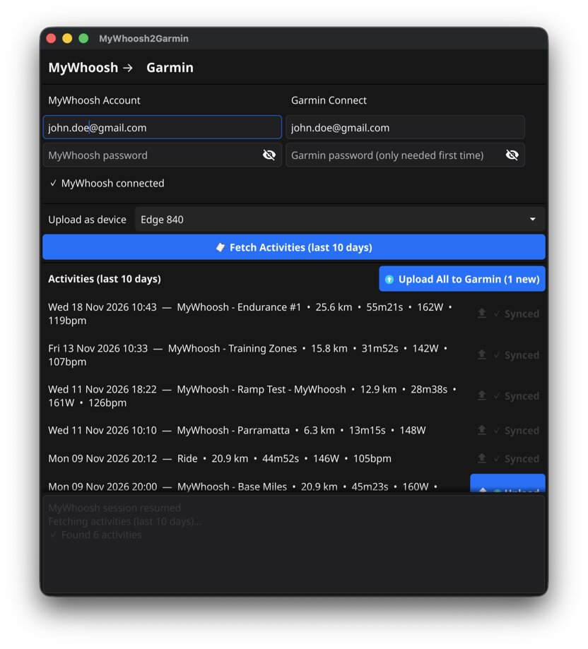

# MyWhoosh2Garmin

> [!NOTE]
> This is a fork of [jdelrue/mywoosh2garmin](https://github.com/jdelrue/mywoosh2garmin) that adds macOS (Apple Silicon) support.

A single-executable GUI app that syncs your [MyWhoosh](https://www.mywhoosh.com/) indoor cycling activities to [Garmin Connect](https://connect.garmin.com/) — with full training effect, VO2max, and performance stats support.

No need to run this on the same PC as MyWhoosh — the app downloads activities directly from your MyWhoosh account.



## Why?

MyWhoosh exports FIT files, but they have issues that prevent Garmin from fully processing them:

- **Missing averages** — average power, heart rate, and cadence are not set in the session data
- **Bogus temperature** — every record contains a fake temperature reading
- **Unknown device** — Garmin ignores training effect and VO2max from unknown manufacturers

MyWhoosh2Garmin fixes all of this automatically:

| Problem | Fix |
|---|---|
| Missing avg power / HR / cadence | Calculated from ride records |
| Fake temperature data | Stripped from all records |
| MyWhoosh device identity | Spoofed to a Garmin device (Fenix 6S Pro or Edge 840) |

The result: your indoor rides show up on Garmin Connect just like a native Garmin recording, complete with **Training Effect**, **VO2max updates**, **Training Load**, and **Training Status**.

## Download

Grab the latest release for your platform from the [**Releases**](../../releases) page:

| Platform | File |
|---|---|
| Windows | `mywhoosh2garmin-windows-amd64.exe` |
| Linux | `mywhoosh2garmin-linux-amd64` |
| macOS (Apple Silicon) | `mywhoosh2garmin-darwin-arm64` |

No installation needed — just download and run.

## How to Use

### 1. Enter MyWhoosh credentials

Enter your **MyWhoosh email** and **password**. These are used to log in to the MyWhoosh API and fetch your activity list.

After the first login, the session token is cached locally (`~/.mywhoosh2garmin/`) so you won't need to enter your password again unless the token expires.

### 2. Enter Garmin credentials

Enter your **Garmin Connect email** and **password**. These are only sent directly to Garmin's SSO servers — never stored or sent anywhere else.

After the first login, a session token is cached locally (`~/.mywhoosh2garmin/`) and reused for up to a year. You won't need to enter your password again unless the token expires.

### 3. Fetch Activities

Click **📋 Fetch Activities (last 10 days)** and the app will:

1. Log in to your MyWhoosh account (or resume a cached session)
2. Fetch your activities from the last 10 days
3. Display them in a list showing date, title, distance, duration, power, and heart rate — with an upload button next to each one

### 4. Upload to Garmin

You can either:

- Click **⬆ Upload** next to individual activities to upload them one by one
- Click **⬆ Upload All to Garmin** to upload all unsynced activities at once

For each activity, the app will:

1. Download the FIT file from MyWhoosh
2. Fix averages, strip temperature, spoof device identity
3. Upload to Garmin Connect
4. Mark the activity as synced so it won't be uploaded again

### Device and serial number

Choose which Garmin device the uploads appear to come from with the **Upload as device** dropdown: **Fenix 6S Pro** (default) or **Edge 840**. The choice is remembered between runs.

On first start the app generates a random serial number and saves it to `~/.mywhoosh2garmin/config.json`, so all your uploads come from the same device. To use your own device's serial instead, change it there:

```json
{
  "serial": 1234567890
}
```

### Local data

Everything the app stores lives in `~/.mywhoosh2garmin/`:

| File | Contents |
|---|---|
| `config.json` | MyWhoosh and Garmin emails, selected device, serial number |
| `mywhoosh_token.json` | Cached MyWhoosh session token |
| `oauth1_token.json`, `oauth2_token.json` | Cached Garmin Connect tokens |
| `synced.json` | IDs of activities already uploaded to Garmin |

Passwords are never stored. Delete this folder to reset the app.

## Building from Source

### Prerequisites

- Go 1.27.4+
- A C compiler, because Fyne needs CGO:
  - Linux: `gcc`, `libgl-dev`, `xorg-dev`, `libxxf86vm-dev`
  - Windows cross-compile from Linux: also `mingw-w64`
  - macOS: Xcode Command Line Tools (`xcode-select --install`)

### Build

For your current platform:

```bash
go build -o mywhoosh2garmin .
```

Release binaries:

```bash
./build.sh
```

`build.sh` clears `dist/` and builds stripped binaries into it, depending on the host OS:

| Host | Output |
|---|---|
| Linux | `mywhoosh2garmin-linux-amd64`, `mywhoosh2garmin-windows-amd64.exe` |
| macOS | `mywhoosh2garmin-darwin-arm64` |

macOS binaries can only be built on macOS.

### Run tests and linter

```bash
go test ./...
golangci-lint run
```

### Inspect a FIT file

`cmd/inspect` dumps the `file_id` and `device_info` messages of a FIT file, which is handy for checking the device spoofing:

```bash
go run ./cmd/inspect activity.fit
```

## How It Works

```
  ┌─────────────────────┐
  │  MyWhoosh Web API   │
  │  Login + List       │
  │  Download FIT file  │
  └─────────┬───────────┘
            │
            ▼
  ┌─────────────────────┐
  │  Decode FIT (V2)    │
  │  Fix session avgs   │
  │  Strip temperature  │
  │  Spoof Garmin device│
  │  Encode FIT (V2)    │
  └─────────┬───────────┘
            │
            ▼
  ┌─────────────────────┐
  │  Garmin SSO Login   │
  │  OAuth1 → OAuth2    │
  │  Upload FIT file    │
  └─────────────────────┘
            │
            ▼
     Garmin Connect
  (Training Effect ✓)
  (VO2max ✓)
  (Training Load ✓)
```

## Credits

- [garth](https://github.com/matin/garth) by matin — Garmin SSO authentication reference
- [muktihari/fit](https://github.com/muktihari/fit) — FIT SDK for Go
- [Fyne](https://fyne.io/) — cross-platform GUI toolkit

## License

GPLv3 — see [LICENSE](LICENSE).
